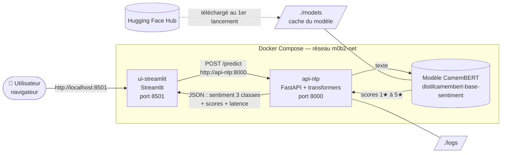

# Analyse — M0-B2 Sentiment Aubergine Hôtels

## Partie 1 — Architecture et lancement

### Schéma d'architecture



**Comment ça marche :**
1. L'utilisateur colle un avis dans l'interface Streamlit (port 8501).
2. Streamlit envoie le texte à l'API (`POST /predict`). Les deux conteneurs se parlent
   par leur nom de service (`api-nlp`) sur le réseau Docker `m0b2-net`.
3. L'API passe le texte au modèle CamemBERT, chargé une seule fois au démarrage.
4. Le modèle renvoie une probabilité pour chaque note de 1★ à 5★. L'API applique la règle
   de mapping (1-2★ → négatif, 3★ → neutre, 4-5★ → positif) et renvoie le résultat.
5. Le modèle est téléchargé depuis Hugging Face au premier lancement, puis gardé dans
   `./models` pour ne pas le retélécharger.

### Lancer la stack

Prérequis : Docker et Docker Compose installés.

```bash
# 1. Créer le fichier de configuration (une seule fois)
cp .env.example .env

# 2. Construire et lancer les deux services
docker compose up --build
```

Le premier lancement est long, car le modèle est téléchargé (environ 250 Mo).
On attend que `docker compose ps` affiche `api-nlp` en `healthy`.

| Service | Adresse |
|---|---|
| Interface utilisateur | http://localhost:8501 |
| API (documentation Swagger) | http://localhost:8000/docs |
| Vérification de l'API | http://localhost:8000/health |

Pour arrêter : `Ctrl+C`, puis `docker compose down`.


## Partie 2 — Avis mal classés

Méthode : les 30 avis de `data/sample_reviews.csv` ont été passés un par un dans
l'interface Streamlit. Règle appliquée : étoile la plus probable, puis 1-2★ → négatif,
3★ → neutre, 4-5★ → positif.

**Résultat : 24 / 30 bien classés (80 %). 6 erreurs.**

| # | Avis (début) | Attendu | Prédit | OK ? |
|---|---|---|---|---|
| 1 | Accueil glacial à la réception… | négatif | négatif | ✅ |
| 2 | Personnel charmant, chambre impeccable… | positif | positif | ✅ |
| 3 | Séjour correct sans plus… | neutre | neutre | ✅ |
| 4 | Chambre superbe avec vue sur le port mais… | neutre | neutre | ✅ |
| 5 | Personnel charmant, comme une porte de prison… | négatif | neutre | ❌ |
| 6 | Vue magnifique, lit confortable… | positif | positif | ✅ |
| 7 | Pas mauvais du tout, on s'attendait à pire… | positif | neutre | ❌ |
| 8 | Mieux que la dernière fois… la douche fuit toujours | négatif | neutre | ❌ |
| 9 | Établissement standard, conforme à la description… | neutre | positif | ❌ |
| 10 | Hôtel d'une médiocrité rare… | négatif | négatif | ✅ |
| 11 | Excellente nuit, accueil au top… | positif | positif | ✅ |
| 12 | On a passé un séjour qu'on n'oubliera pas… | négatif | positif | ❌ |
| 13 | Petit déjeuner buffet correct mais sans surprise… | neutre | neutre | ✅ |
| 14 | Réception agréable, chambre récemment rénovée… | positif | positif | ✅ |
| 15 | Conditions sanitaires limites… | négatif | négatif | ✅ |
| 16 | Bonne situation centrale, parking pratique… | positif | positif | ✅ |
| 17 | L'hôtel n'est plus ce qu'il était… | négatif | négatif | ✅ |
| 18 | Séjour neutre, sans plus… Rien de mémorable. | neutre | négatif | ❌ |
| 19 | Quelle déception après les avis enthousiastes… | négatif | négatif | ✅ |
| 20 | Charmant, décoration soignée… | positif | positif | ✅ |
| 21 | Hôtel correct, sans plus, sans moins… | neutre | neutre | ✅ |
| 22 | Personnel adorable qui s'est mis en quatre… | positif | positif | ✅ |
| 23 | Wifi quasi inexistant… Évitez. | négatif | négatif | ✅ |
| 24 | Très bonne surprise, vraie attention aux détails… | positif | positif | ✅ |
| 25 | Hôtel propre, bien tenu, mais sans personnalité… | neutre | neutre | ✅ |
| 26 | Si vous aimez attendre 25 minutes… | négatif | négatif | ✅ |
| 27 | Pas mal du tout pour le prix… | positif | positif | ✅ |
| 28 | Chambre lumineuse, accueil pro, mais les murs sont fins… | neutre | neutre | ✅ |
| 29 | Que dire à part que c'était parfait… | positif | positif | ✅ |
| 30 | Annulez votre réservation tant qu'il est temps… | négatif | négatif | ✅ |

### Analyse des erreurs

**Avis n°12 — Ironie (l'erreur la plus grave)**
> « On a passé un séjour qu'on n'oubliera pas. La climatisation en panne en plein août, sympa. »

Prédit **positif** (4★ = 51 %, 5★ = 40 %) au lieu de négatif. Le modèle lit les mots
« qu'on n'oubliera pas » et « sympa » au premier degré. Il ne comprend pas que le client
se moque. C'est l'erreur la plus coûteuse pour Aubergine : un client furieux, avec une
panne réelle à réparer, est classé satisfait, et aucune alerte n'est envoyée.

**Avis n°5 — Ironie**
> « Personnel charmant, comme une porte de prison. Trois quarts d'heure d'attente au check-in. »

Prédit **neutre** (3★ = 32 %) au lieu de négatif. « Charmant » tire vers le positif et
la suite vers le négatif : le modèle hésite et tombe au milieu. Ici, la somme des
probabilités par groupe aurait donné le bon résultat : négatif = 1★ + 2★ = 37 %, devant
neutre = 32 % et positif = 31 %.

**Avis n°8 — Comparatif**
> « Mieux que la dernière fois, c'est déjà ça. Reste que la douche fuit toujours. »

Prédit **neutre** (3★ = 36 %, 2★ = 35 %) au lieu de négatif. « Mieux que » est un
comparatif positif, mais par rapport à une première expérience déjà mauvaise. Le modèle
ne fait pas ce lien et le prend comme un point positif. L'écart est de 1 point
seulement : avec la somme par groupe, négatif = 45 %, l'avis aurait été bien classé.
Encore un client mécontent non repéré, avec un problème matériel non réglé.

**Avis n°7 — Négation**
> « Pas mauvais du tout, on s'attendait à pire vu les avis. Bonne surprise… »

Prédit **neutre** (3★ = 67 %) au lieu de positif. Le modèle repère « mauvais » et « pire »
mais comprend mal la négation « pas mauvais du tout », qui veut dire « bien ». Erreur peu
coûteuse : aucune alerte inutile, on rate juste un client content.

**Avis n°18 — Ambivalence (frontière 2★ / 3★)**
> « Séjour neutre, sans plus. Le personnel fait son travail… Rien de mémorable. »

Prédit **négatif** (2★ = 49 %, 3★ = 45 %) au lieu de neutre. « Sans plus » et « rien de
mémorable » sonnent comme des reproches, alors que le client est juste indifférent. Le
modèle hésite entre 2★ et 3★ et bascule du mauvais côté. C'est une fausse alerte pour
le directeur.

**Avis n°9 — Autre : l'absence de reproche lue comme de la satisfaction**
> « Établissement standard, conforme à la description. Rien à signaler de particulier. »

Prédit **positif** (4★ = 55 %) au lieu de neutre. Le modèle a sans doute appris sur des
avis où « conforme » et « rien à signaler » accompagnent une bonne note : pour lui,
pas de plainte veut dire client content. Erreur sans conséquence pour le métier.

### Bilan

| Type d'erreur | Avis | Conséquence métier |
|---|---|---|
| Mécontent non repéré | 5, 8, 12 | coûteux : client perdu, problème non réglé |
| Fausse alerte | 18 | gênant : temps perdu pour l'équipe |
| Confusion neutre / positif | 7, 9 | sans conséquence (pas d'alerte en jeu) |

Les erreurs les plus graves viennent de l'**ironie** et du **comparatif** : le modèle
lit les mots un par un sans saisir le second degré. Avec la variante (somme des
probabilités par groupe), les avis n°5 et 8 auraient été bien classés, soit 26/30.
L'avis n°12 serait resté faux, car le modèle y est sûr de lui à tort.


## Partie 3 — Justification du mapping

### Règle retenue

| Étoiles du modèle | Classe métier |
|---|---|
| 1★ – 2★ | négatif |
| 3★ | neutre |
| 4★ – 5★ | positif |

Méthode : on garde l'étoile la plus probable, puis on applique la règle.

### Pourquoi ce découpage

Le modèle se trompera de toute façon. Le choix du découpage revient donc à choisir
**quelle erreur on accepte le plus**, en fonction de ce qu'elle coûte à Aubergine Hôtels.

**Argument 1 — Un client mécontent non repéré coûte cher : les 2★ vont en négatif.**
Un client mécontent qu'on ne repère pas ne revient pas et peut laisser un mauvais avis
public. Surtout, le problème qu'il signale n'est jamais réglé : l'avis n°8 (2★) parle
d'une douche qui fuit *toujours*. Classer les 2★ en neutre ferait rater ces signaux.

**Argument 2 — Une alerte à tort use l'attention de l'équipe : les 3★ restent neutres.**
Les avis 3★ (« correct sans plus », « rien à signaler ») ne demandent aucune action.
Les classer en négatif enverrait au directeur des dizaines d'alertes inutiles. À force,
il ne les lirait plus, et les vraies alertes passeraient elles aussi inaperçues.

### Comparaison chiffrée avec les autres découpages

Sur les 30 avis de `sample_reviews.csv`, avec les mêmes prédictions du modèle :

| Découpage | Bien classés | Mécontents ratés (sur 11) | Fausses alertes |
|---|---|---|---|
| **A — 1-2 / 3 / 4-5 (retenu)** | **24 / 30** | 3 | 1 |
| B — exigeant : 1-2-3 / 4 / 5 | 17 / 30 | 1 | 8 |
| C — prudent : 1 / 2-3-4 / 5 | 18 / 30 | 7 | 0 |

- **B** rate le moins de mécontents, mais transforme chaque 3★ en alerte : 8 fausses
  alertes sur 30 avis, ce qui est intenable pour une équipe d'hôtel.
- **C** n'envoie aucune fausse alerte, mais laisse passer 7 clients mécontents sur 11.
- **A** est le meilleur compromis entre ces deux coûts.

### Limite et piste d'amélioration

La règle « étoile la plus probable » ignore les hésitations du modèle. Sur l'avis n°5
(ironie), le modèle donne 3★ = 32 % mais 1★ + 2★ = 37 %. En **additionnant les
probabilités par groupe**, les avis n°5 et 8 auraient été bien classés (26/30).
Cette variante serait une amélioration simple à tester. Elle ne résout pas tout :
l'ironie franche (avis n°12, ou « Accueil incroyable, surtout si on était censé être
dans un bar/tabac ») trompe le modèle avec assurance, et aucun découpage ne la rattrape.
